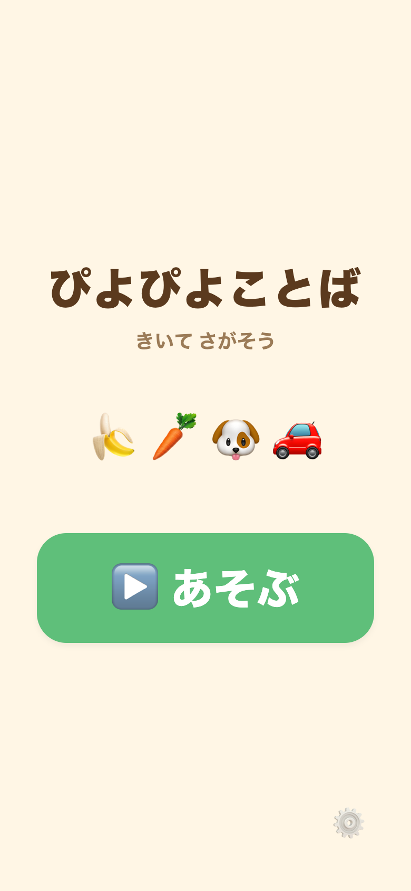

# ぴよぴよことば

4〜5歳児のための、超やさしい「ことば・語彙」知育アプリ。**ベルトコンベアで やさい・くだもの・どうぶつ・のりもの の絵文字がゆっくり流れてくる**。「**ばなな は どれ？**」の出題（ひらがな＋🔊読み上げ）に、流れてくるものから **絵で** こたえる単語帳あそび。正解すると ぽんっと拡大＋「ばなな！」＋読み上げ＋⭐。まちがえても ぷるぷる揺れるだけ（罰なし）。



「ぴよぴよランド」3作目。第1作 [おつかいめいろ](https://github.com/kerokero-1245/otsukai-meiro)・第2作 [ぴよぴよさんすう](https://github.com/kerokero-1245/piyopiyo-sansu) と同系統。UX原則・配布方針・技術スタック・部品を流用。街（ランチャー）の施設名は「やおやさん」🥕。

## 公開URL

**▶ https://kerokero-1245.github.io/piyopiyo-kotoba/**

ブラウザで開いてそのまま遊べる。スマホなら「ホーム画面に追加」で全画面起動。`main` に push すると GitHub Actions（[.github/workflows/deploy.yml](.github/workflows/deploy.yml)）が Web を書き出して自動デプロイする。

整形の検査（`format:check`）・ESLint（`lint`）・型チェック（`typecheck`）・テスト（`npm test`）が通り、Web の書き出しができたときだけ公開し、PR でも同じ検査を回す。

- 設計（コンセプト・出題ロジック・TTS方針・4歳UX・ロードマップ）: [docs/DESIGN.md](docs/DESIGN.md)
- 作り方の規則と、この repo で違うこと: [docs/DESIGN.md](docs/DESIGN.md#この-repo-での適用)

## 状態

**フェーズ1（MVP）実装済み・Webファースト。** タイトル → もんだい（ベルトコンベア出題×5）→ がんばりカード まで遊べる。辞書は約40語（やさい・くだもの・どうぶつ・のりもの ×約10）。選択肢は「各カテゴリから最大1語」で紛らわしさを構造的に排除。読み上げは **VOICEVOX で事前生成した同梱クリップ（ずんだもん・あまあま）を最優先**に、無ければブラウザ内蔵の `speechSynthesis`（`ja-JP`）へフォールバック。効果音は Web Audio 合成、ベルトは React Native 標準 `Animated` の無限ループ。おとなモードでカテゴリのオン/オフ・読み上げのオン/オフ・⭐リセットができる。

配布は **Webファースト**: Expo の web ビルドを URL で配布し、ブラウザで開いて「ホーム画面に追加」すれば全画面で遊べる。詳細は [DESIGN.md §0](docs/DESIGN.md)。

## 前提・方針

- 対象: 4〜5歳（未就学・ひらがなは読み始め）。育てたいのは**語彙**（聞いた語 → 実物イメージの結びつき）。
- 文字を読ませるのではなく「ことばを聞いて／見て、絵をさがす」体験に徹する。
- 罰・タイマー・スコア・ゲームオーバーなし。**失敗状態を作らない**（ベルトはループし続ける）。まちがいはぷるぷる震えるだけ。
- 既存キャラIPは使わない。MVPは絵文字プレースホルダ。
- 完全オフライン: バックエンド・アカウント・通信・外部送信なし。TTSも端末内合成。設定・累計⭐は端末内のみ。
- 技術: Expo SDK 57 (React Native + TypeScript)、Node 24.21.0、アニメは標準 `Animated`、読み上げは `speechSynthesis`。

## TTS（読み上げ）について

読み上げは **3段構え**（`src/audio/voice.ts`）: ①同梱クリップ → ②`speechSynthesis` → ③無音。
出題時（「ばなな は どれ？」の出題文を1回）・🔊タップ時と正解時（単語）に鳴る（おとなモードでオフにできる）。新しい声は前の声を止めてから鳴らす。iOS Safari は最初のユーザー操作より前に発声できないため、タイトルの「あそぶ」タップで1回だけアンロックする。**読み上げが使えない環境（未対応・声なし・オフ）でも、ひらがな表示だけでゲームは完全に成立する**（TTS必須ではない）。

- **①同梱クリップ（tier1）**: **VOICEVOX** で事前生成した音声（`assets/voice/*.m4a`・84個＝単語40・出題文40（`ask_*`）・定型句4・約1.8MB）を同梱し、あれば最優先で再生する。話者は **ずんだもん（あまあま）**、4〜5歳向けにやや遅め（`speedScale` 0.92）。クレジット: **VOICEVOX:ずんだもん**（おとなモード画面下部にも表示）。生成の再現情報は [assets/voice/README.md](assets/voice/README.md)。
- **②`speechSynthesis`（tier2）**: クリップが無い基名・未対応環境ではブラウザ内蔵の日本語合成（`ja-JP`）へフォールバック。
- 音声はいずれも端末内で完結（**外部送信ゼロ**）。同梱クリップもネットワークを使わないバンドルアセット。

## BGM（背景曲）について

やさしいオルゴール風の背景曲（曲 `kotoba`・D メジャーペンタ・92BPM・16小節シームレスループ）を控えめな音量で流す。ぴよぴよランド4姉妹アプリ共通の**共有BGM基盤**（`src/audio/bgm.ts` → 共有パッケージ [piyo-assets](https://github.com/kerokero-1245/piyo-assets) の `bgm/engine`。`package.json` の git 依存で、タグで固定した版を読む）を使い、**Web Audio API でその場合成**する手続き生成ループ。音源ファイルは同梱せず、録音物・外部素材は使っていない（**外部送信ゼロ・完全オフライン**）。

- **クレジット: BGM: オリジナル（Web Audio生成）**。
- **初期状態 ON**（控えめ音量）。おとなモードの「BGM ながす/ながさない」で切り替え（保存キー `kotoba.bgm`・`localStorage`）。
- **開始はユーザー操作起点**（タイトルの「あそぶ」/タイトル読み上げタップ）で `startBgm('kotoba')`。iOS Safari の自動再生制限を守る。
- **ダッキング**: 単語よみあげ（`sayWord`）・誤答の声かけ・タイトル読み上げの再生中は BGM をそっと下げ、声が終わると少し待ってなめらかに戻す（`voice.ts` が `duckBgm`/`unduckBgm` を制御）。発話頻度が高いので単段・世代番号・戻し猶予でフラップを防ぐ。
- **AudioContext は効果音（`sounds.ts`）と共有**（`configureBgm({ getCtx })`）。AudioContext 非対応・`localStorage` 例外でも全 API は無害（クラッシュしない・ひらがな表示だけで成立）。

## 動かし方

前提: **Node は `.nvmrc` の版**。nvm なら `nvm use`（`.nvmrc` を読む）。

```sh
npm install          # 初回のみ
npm start            # Expo を起動 → ターミナルで w を押すと Web が開く
```

- `w` … ブラウザで開く（Webファースト。まずはこれ）
- `i` / `a` … iOS シミュレータ / Android エミュレータ（任意）

ショートカット: `npm run web`。型の確認は `npm run typecheck`（`tsc --noEmit`）。
テストは `npm test`（Node 標準の `node --test`。`tests/register.mjs` が .ts/.tsx の読み込みと react-native・素材の差し替えを受け持つので、依存は増えない）。
読み込みの仕組み（.ts の変換・react-native と expo の差し替え）と偽の localStorage・種つき乱数は piyo-assets の `testing/` から読み、tests/register.mjs・tests/stubs/・tests/helpers.ts にはこのアプリの差分だけを書く。

### Web ビルド（配布用の静的サイト書き出し）

```sh
npx expo export --platform web      # dist/ に静的ファイルを書き出す（ルート配信用）
```

GitHub Pages はサブパス（`/piyopiyo-kotoba/`）配信のため、CI では `EXPO_BASE_URL=/piyopiyo-kotoba` を渡して書き出す。この環境変数を [app.config.js](app.config.js) が `experiments.baseUrl` に反映し、**ビルド時のみ**アセットのベースパスを付ける（ローカルの `npm start` には影響しない）。手元で再現するなら:

```sh
EXPO_BASE_URL=/piyopiyo-kotoba npx expo export --platform web
```

公開 HTML の型は [public/index.html](public/index.html)（`lang="ja"`・説明文・OGP・manifest へのリンク・読み込み中の背景色）。`public/` のほかのファイル（`manifest.webmanifest`・`icon-192.png`・`icon-512.png`・`apple-touch-icon.png`・OGP 画像 `og.png`）は書き出しにそのままコピーされる。アイコン類（`public/` と `assets/` の PNG）は、街の やおやさん と同じ自作 SVG（piyo-assets の `ninjin.svg`。`assets/svg/ninjin.svg` と同一）から作った。

### 遊び方（フェーズ1）

タイトルの「あそぶ」→ もんだい画面。出題バー「◯◯ は どれ？」（出題と同時に1回読み上げ。🔊 で ことばを もういちど きける＝出題文ではなく単語）を聞いて、ベルトコンベアを右→左に流れてくる絵から正しいものをタップ。正解すると ぽんっと大きくなって「◯◯！」と読み上げ、⭐がたまる。まちがえるとその絵がぷるぷる震えるだけ（罰なし・ベルトは流れ続ける）。5問おわると「きょうの がんばりカード」。
※ タイトル右下の歯車を **3秒長押し** すると、おとなモード（カテゴリのオン/オフ・読み上げのオン/オフ・⭐リセット）に入る。
※ タイトル左上の「まちへ もどる」で ぴよぴよランド（同じオリジンの `/`）へ戻る（Web のみ。もんだい・がんばりカード・おとなモードには置かない）。

**⭐**: 1問クリアごとに累計 `kotoba.totalStars` が1つ増え（再挑戦してからのクリアも +1）、街（ぴよぴよランド）の やおやさん がこれを燃料として読む。おとなモードの「0に もどす」は、ことばの中の「あつめた ほし」（おとなモード・がんばりカード）だけを 0 から数え直す（もどした時点の累計を `kotoba.starsResetAt` に控える）。**街へ渡す累計 `kotoba.totalStars` は減らさない。** 控えが累計より大きい（累計だけ消えた・書き換えられた等）と分かったら、その控えは捨てる（キーを消し、表示は累計そのまま。累計は書き換えない）。

## 画面・ファイル構成

```
App.tsx                     文字ヘッダ無しの最小ステートルーター（title→play→otona）
src/
  theme.ts                  配色・フォント・余白の基準値（4歳向け）
  types.ts                  CategoryId / WordItem / Question / Route
  settings.ts               カテゴリ・もじ・読み上げ・BGM・累計⭐（kotoba.*）の保存（web は localStorage）
  game/
    words.ts                単語辞書（約40語・4カテゴリ）＋カテゴリ定義
    quiz.ts                 出題生成（generateQuestion / generateSet / 選択肢生成）
  audio/
    sounds.ts               効果音（web は Web Audio 合成、native は無音スタブ）
    voice.ts                読み上げの入口。3段構え（①同梱クリップ→②speechSynthesis→③無音）
    clips.ts                tier1: 同梱音声クリップ再生（web は Audio 要素、native 無音スタブ）
    voiceClips.ts           同梱クリップの登録表（CLIP_URLS）。VOICEVOX 生成の m4a 84個を登録済み
    speech.ts               tier2: speechSynthesis（web、native は無音スタブ）
    bgm.ts                  BGM 配線の入口（曲=kotoba / 初期ON / トグル kotoba.bgm / 声ダッキング / ctx共有）。エンジンと曲のデータは src/ に置かず、共有パッケージ piyo-assets（`@kerokero-1245/piyo-assets/bgm/engine`）から読む
  components/
    Belt.tsx                ベルトコンベア（無限スクロール＋タップ＋ぷるぷる）
    RevealCard.tsx          正解の ぽんっと拡大＋「◯◯！」
    ClearOverlay.tsx        「きょうの がんばりカード」セット完了の祝福
  screens/
    TitleScreen.tsx         タイトル（あそぶ / まちへ もどる / 親ゲート / TTSアンロック）
    PlayScreen.tsx          もんだい本体（出題バー→ベルト→正解/ぷるぷる→次へ）
    OtonaScreen.tsx         おとなモード（カテゴリ・もじ・読み上げ・BGM・⭐リセット）
public/                     Web 書き出しの HTML の型・manifest・アイコン・OGP 画像
```

大ボタン・進捗ドット・紙吹雪・「まちへ もどる」（街へのリンク）・おとなモードの長押しは src/ に置かず、共有パッケージ piyo-assets の部品ごとの入口 `@kerokero-1245/piyo-assets/ui/<部品名>`（`ui/BigButton`・`ui/ProgressStar`・`ui/Confetti`・`ui/TownLink`・`ui/useLongPress`）から読む（見た目の値は App.tsx の `PiyoUiProvider`（`ui/tokens`）で `src/theme.ts` から渡す。進捗の⭐は絵文字で出すので、`ui/ProgressStar` の `EMOJI_MARK` を `mark` に渡す）。まとめての入口 `@kerokero-1245/piyo-assets/ui` からは読まない（使わない部品の絵まで書き出されるため）。
